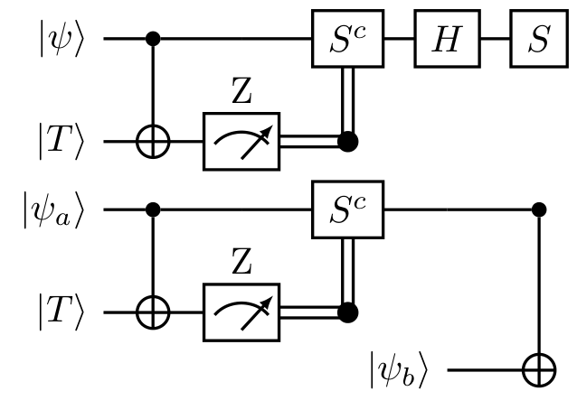
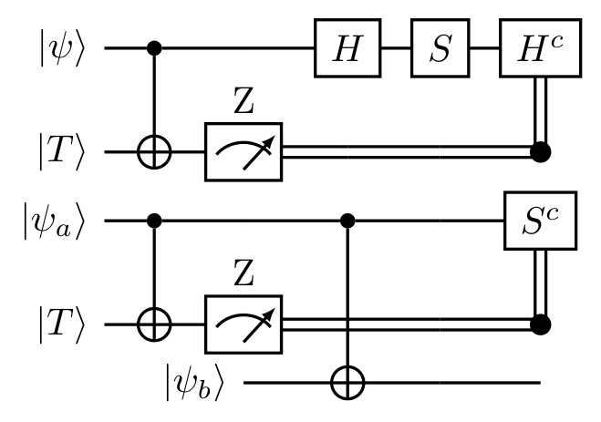

# qSink compiler

qSink compiles Clifford+T OpenQASM circuits into lattice-surgery schedules.
It moves measurement-dependent corrections past compatible operations so
those operations can proceed while the decoder works. The compiler writes
an RTLS schedule that describes the lattice slices and tells the runtime
which measurement outcomes control the corrections.

The lattice-surgery backend builds on
[LibLSQECC](https://github.com/latticesurgery-com/liblsqecc).

## Table of contents

- [Supported transformations](#supported-transformations)
- [Build](#build)
- [Using qSink](#using-qsink)
  - [Run the bundled example](#run-the-bundled-example)
  - [Compile your own circuit](#compile-your-own-circuit)
  - [OpenQASM input](#openqasm-input)
  - [Read the HTML report](#read-the-html-report)
  - [RTLS file format](#rtls-file-format)
- [Examples](#examples)
- [Compare with LibLSQECC](#compare-with-liblsqecc)
- [Project background](#project-background)

## Supported transformations

| Before qSink | After qSink |
| --- | --- |
|  |  |

**Representative qSink transformations.** The top shows the temporal
sequence T → S<sub>cond</sub> → H → S transformed into
T → H → S → H<sub>cond</sub>, up to a Pauli-frame update. The bottom illustrates
how a pending conditional correction can move past the initial M<sub>Z</sub>
stage of a measurement-based CNOT.

qSink looks for these patterns on the qubit with a pending S or S†
correction from a T or T† injection. Phase commutation can precede either
of the other two rewrites.

| Pattern | What qSink does |
| --- | --- |
| S or S† | Moves the pending correction past the phase gates. |
| H → S | Rewrites the pending correction as a conditional H after the pair, with a conditional X frame update. |
| CNOT involving that qubit as control or target | Splits the CNOT so the pending correction can run between its Z ⊗ Z and X ⊗ X measurement stages. |

## Build

Use Bash, CMake, and a C++20 compiler with its standard library and build
tools. The build was tested on Linux with GCC 12 and CMake 3.22. Required
headers are bundled. Install Boost.Graph development headers to enable
the optional Boost-backed graph search. [Vendored dependencies](DEPENDENCIES.md)

Build from the checkout root.

```bash
./build.sh
```

The script prints the path to the executable, normally `build/qsink`.
Set `QSINK_BUILD_DIR` to choose another build directory or
`QSINK_BUILD_JOBS` to adjust the parallel job count.

## Using qSink

### Run the bundled example

The two-qubit demo shows corrections moving past S†, past an H → S pair,
and into a split CNOT. [Demo input](examples/compact_layout_demo/compact_layout_demo.qasm)

```bash
./scripts/run_example.sh
```

The script writes only `output/demo.rtls`. If you set `QSINK_BUILD_DIR` when
building, pass the same setting here. To see the result in a browser,
[generate the optional HTML report](#read-the-html-report) or open the
[bundled HTML report](examples/compact_layout_demo/compact_layout_demo.html).

### Compile your own circuit

Pass your OpenQASM file to the same script to use the demo's scheduler and
layout settings.

```bash
./scripts/run_example.sh /path/to/circuit.qasm output/my_circuit
```

Call the compiler directly to choose your own settings. This command uses
the demo settings as a starting point.

```bash
mkdir -p output
./build/qsink -q -i /path/to/circuit.qasm -L edpc -P wave \
    --disttime 1 --nostagger -o output/my_circuit
```

| Option | What it controls |
| --- | --- |
| `-q -i <file>` | Reads the input file as OpenQASM. |
| `-o <path>` | Writes the RTLS schedule to a file, appending `.rtls` if needed. Omitting `-o` writes the schedule to standard output. |
| `-L edpc` | Selects the EDPC layout. The compiler defaults to `compact`. |
| `-P wave` | Selects the wave scheduler. The compiler defaults to `stream`. Both support RTLS output. |
| `--disttime 1` | Sets the magic-state distillation time to one slice. |
| `--nostagger` | Disables staggered distillation timing. |
| `--no-ths-opt` | Disables sinking corrections past H → S. |

Run `./build/qsink --help` for the full option list.

### OpenQASM input

Use OpenQASM 2.0 with one quantum register, indexed qubit operands, and
one statement per line. The basic gate set includes `h`, `x`, `y`, `z`, `s`,
`sdg`, `t`, `tdg`, `cx`, and `cz`. Indexed `reset` is supported.

For example, save these lines as `circuit.qasm` to try the H → S rewrite.

```qasm
OPENQASM 2.0;
include "qelib1.inc";

qreg q[1];
t q[0];
h q[0];
s q[0];
```

The parser skips source `measure` and `barrier` statements and strips
`if (...)` predicates, so supply circuits whose gates do not depend on
classical control. Expand custom gates and synthesize arbitrary rotations
into Clifford+T before compiling. For rotation synthesis, see the
[Qiskit GridSynth plugin](https://github.com/qqq-wisc/qiskit_gridsynth_plugin).

### Read the HTML report

Run the optional visualizer on any `.rtls` file, then open the generated
HTML in a browser. The visualizer uses the Python standard library and
was tested with Python 3.10. [RTLS visualizer](tools/rtls_visualize.py)

```bash
python3 tools/rtls_visualize.py output/demo.rtls --require-complete-links
```

The visualizer writes the HTML alongside the RTLS file by default. Use
`--out-prefix` to change the destination. The `--require-complete-links` flag
checks that each correction sunk into a CNOT links to both stages.

- Use the slider or **Previous** and **Next** to move through zero-based
  slices. Khaki cells are qubit patches, purple cells represent distillation
  or prepared states, and aquamarine cells are ancillas. Blue and red circles
  mark unitary and measurement activity, respectively. The number below an
  operation label is its RTLS ID with the `op_` prefix omitted.
- Read **Correction Chains** to find each injection body (`T*` or `T*dg` in
  the grid) and its correction (`cS`, `cSdg`, or `cH`). The **Correction**
  column gives the correction's ID and its first slice after `@`. The grid
  shows where the correction is scheduled if the decoded outcome calls for it.
  A latency of `0` with an S or S† anchor shows phase commutation. An
  `'hs'` row shows a pending correction rewritten as `cH` after H → S.
  The **Auxiliary Pauli Frame Corrections** table lists conditional software
  frame updates, including byproducts of the H → S rewrite and split CNOT.
- For a row with latency `'mz'`, **Anchor** identifies `Mz`, the stage
  containing the joint Z ⊗ Z measurement of the control and ancilla.
  **Post** identifies `Mx`, the stage that measures X ⊗ X on the same ancilla
  and the target, then reads out the ancilla in Z with the example settings.
  **Detail** gives the last `Mz` slice, the first correction slice, and the
  first `Mx` slice. The first two slice indices can be equal. In the bundled
  demo, `Mz` and `cSdg` appear in slice 14 and `Mx` starts in slice 16.
  [Demo HTML](examples/compact_layout_demo/compact_layout_demo.html)

### RTLS file format

An RTLS file is a JSON array of time slices in execution order. Each slice is
a lattice grid indexed as `schedule[slice][row][column]`, starting at zero.
An empty grid position is `null`. Each occupied cell has the following fields.

| Cell field | Meaning |
| --- | --- |
| `patch_type` | `Qubit` for a qubit patch, `DistillationQubit` for distillation or a prepared state, or `Ancilla` for routing and ancillary cells. |
| `text` | Display label, such as a patch ID or a magic-state countdown. It can be empty. |
| `edges` | Boundary styles on `Top`, `Bottom`, `Left`, and `Right`. `Solid` means smooth, `Dashed` means rough, the `Stiched` variants mark active boundaries, `AncillaJoin` marks a join, and `None` means no edge is drawn. |
| `activity` | Physical activity and any Pauli-frame updates for the cell in this slice. |
| `operation_id` | Optional underlying multi-patch measurement ID, stored as a numeric string. |

Activity fields appear where applicable. A logical operation can span several
cells and slices, which share its `operation-id`.

| Activity field | Meaning |
| --- | --- |
| `activity_type` | `Unitary`, `Measurement`, or `null` when the cell has no drawn physical activity. |
| `operation` | Logical operation name, such as `TStar` or `TStardg` for a T or T† injection body, or `CondS`, `CondSdg`, or `CondH` for a correction. |
| `operation-id` | RTLS identifier for the logical operation, such as `op_000001`. |
| `conditional` | `true` if execution depends on a decoded measurement outcome. |
| `conditional-correction-id` | On the injection body, the first slice of its correction. |
| `conditional-correction-operation-id` | On the injection body, the operation ID of its correction. |
| `conditional-correction-latency` | Rewrite category. `0` covers an immediate correction or one commuted past S/S†, `hs` marks sinking past H → S, and `mz` marks sinking into a split CNOT. |
| `conditional-correction-anchor-operation-id` | On the injection body, the operation ID that anchors the correction's placement. |
| `conditional-correction-post-anchor-operation-id` | On the injection body, the ID of the split CNOT's `Mx` stage, which follows the correction. |
| `correction-for-operation-id` | On a correction, the ID of the operation whose measurement supplies the condition. |
| `condition-source-slice` | The first slice of that source operation. |
| `correction-anchor-operation-id` | On a correction, the ID of its placement anchor. A Pauli-frame update can share a slice with its anchor. |
| `correction-post-anchor-operation-id` | On a correction, the ID of the split CNOT's `Mx` stage that follows it. |
| `frame-updates` | List of Pauli-frame updates for the cell. Entries reuse the operation and condition fields above. |

Follow `conditional-correction-operation-id` from a T/T† injection body to
the scheduled correction, then use `correction-for-operation-id` to trace
back to the operation that supplies the condition. A runtime can use these
links and the decoded outcomes to decide which scheduled corrections to
execute.

## Examples

Each folder contains the input `.qasm`, the qSink schedule and HTML report,
and a `*_liblsqecc.json` schedule for the same input and settings.

| Circuit | Transformation to look for |
| --- | --- |
| [Bundled two-qubit demo](examples/compact_layout_demo/) | S† commutation, H → S sinking, and a split CNOT |
| [Adder](examples/small_adder_n4/) | Split CNOTs |
| [Fredkin](examples/small_fredkin_n3/) | Split CNOTs |
| [Simon](examples/small_simon_n6/) | Split CNOTs |
| [Teleportation](examples/small_teleportation_n3/) | H → S sinking |
| [Toffoli](examples/small_toffoli_n3/) | Split CNOTs |

## Compare with LibLSQECC

The bundled comparison files were generated with upstream LibLSQECC at
commit `3b808044e4bbd7b544a00423d6cbc84cb60116ca`. The example inputs omit
terminal measurement statements for compatibility with that version.
Run the same circuit with the same layout, scheduler, and distillation
settings to generate a baseline.

```bash
mkdir -p output
lsqecc_slicer -q -i examples/compact_layout_demo/compact_layout_demo.qasm \
    -L edpc -P wave --disttime 1 --nostagger -o output/demo_liblsqecc.json
```

This command uses `-q` from the version above. For versions that use
`--input-format`, pass `-I qasm` in its place.
[Upstream CLI documentation](https://github.com/latticesurgery-com/liblsqecc#using-lsqecc_slicer)

## Project background

Alessio Cicero, Luigi Altamura, Mats Granath, and Pedro Trancoso.
*qSink: Hiding QEC Decoder Latency through Conditional-Correction Sinking*.

The repository also includes the scripts and data for the paper's plots.
[Plotting script](scripts/make_figures.py) · [Figure data](artifact-files/figure-data)
· [Plotting dependencies](requirements-figures.txt)

[License](LICENSE) · [Vendored dependency notices](DEPENDENCIES.md)
